# Frontend Engineering Skills & Architecture Guide

This document outlines the specialized frontend engineering skills, architecture paradigms, and design engineering principles demonstrated in this codebase (**Anvik Labs** — a high-end, editorial product design and technology studio portfolio).

---

## 1. Archetype & Website Classification

| Characteristic | Specification |
| :--- | :--- |
| **Website Archetype** | High-end Editorial Studio Portfolio / Design Engineering Showcase |
| **Aesthetic Paradigm** | Dark Editorial Minimalist (Swiss typography meets tactile digital craft) |
| **Core Philosophy** | Content-first, typography-driven, zero decorative bloat, hairlines over cards, single vivid accent (`#ff6a00`) |
| **Runtime Architecture** | React Router 8 (Framework mode) + Vite + React 19 (Prerendered SSG + Client Hydration) |
| **Styling Engine** | Tailwind CSS v4 (CSS-first `@theme` configuration, zero PostCSS config) |
| **Animation Engine** | Framer Motion (Spring physics & viewport triggers) + Native GPU CSS Keyframes |

---

## 2. Core Frontend Skill Matrix

```mermaid
graph TD
    A[Frontend Engineering Core] --> B[Modern Framework & Tooling]
    A --> C[Design Engineering & Editorial UI]
    A --> D[Motion Choreography & Physics]
    A --> E[Accessibility & Contrast Compliance]
    A --> F[Performance & Core Web Vitals]
    A --> G[Responsive Architecture]

    B --> B1[React 19 & React Router 8]
    B --> B2[Tailwind CSS v4 @theme]
    B --> B3[Vite Bundler & Typegen]

    C --> C1[Fluid Typography clamp]
    C --> C2[Dual-Voice Typography]
    C --> C3[Hairline Grid & Surfaces]

    D --> D1[Spring Dynamics]
    D --> D2[Cursor Parallax]
    D --> D3[Compositor Marquees]

    E --> E1[Dark Mode Contrast > 15:1]
    E --> E2[prefers-reduced-motion]
    E --> E3[Aria & Screen Reader Fallbacks]

    F --> F1[LCP & Asset Preloading]
    F --> F2[Zero Cumulative Layout Shift]
    F --> F3[SSG Prerendering]

    G --> G1[Responsive Drawer & Locks]
    G --> G2[Adaptive Layouts contents]
    G --> G3[Touch Target Sizing]
```



---

## 3. Detailed Competency Breakdown

### 3.1 Framework & Architecture Competencies

- **React 19 & React Router 8 (Remix lineage)**:
  - Prerendered static generation with client-side hydration (`react-router build` + route prerender).
  - Explicit declarative routing using `src/routes.ts` instead of fragile file-system routing.
  - State preservation across navigation via `ScrollRestoration` and custom hash-scrolling hooks.
  - Hydration safety with `suppressHydrationWarning` and pure client components where necessary.
- **Tailwind CSS v4 (Modern Engine)**:
  - Direct CSS-based `@theme` tokens in `src/app/globals.css` eliminating legacy `tailwind.config.js`.
  - CSS custom properties (`--color-foreground`, `--color-accent`, etc.) mapped to utilities.
  - Use of modern CSS properties: `text-wrap: balance`, `text-wrap: pretty`, `will-change-transform`.
- **TypeScript Strict Typing**:
  - React Router auto-generated route types (`react-router typegen`).
  - Strict type contracts for works, testimonials, and route parameters.

---

### 3.2 Design Engineering & Editorial Aesthetics

- **The "Editorial, Not SaaS" Discipline**:
  - Avoiding generic SaaS templates: no heavy drop shadows, neon glows, glassmorphism blur cards, or multicolor gradients.
  - Relying on negative space, crisp hairline borders (`rgba(255, 255, 255, 0.12)`), and exact typographic contrast.
  - **Single Accent Rule**: Orange (`#ff6a00`) is used strictly as a focal punctuation mark (status dots, active states, key CTAs, inline highlights), never diluted with secondary accents.
- **Dual Typographic Voice**:
  - **Voice 1: Display & Body (`Inter Display`)**: High legibility, negative tracking (`tracking-[-0.04em]`), tight leading (`0.95` to `1.08` for display titles).
  - **Voice 2: Metadata & Annotations (`Monospace`)**: Uppercase, tracked out (`tracking-[0.12em]` to `0.2em`), 11px–13px, used exclusively for technical labels, indices (`[01]`), timestamps, and controls.
  - **Specialist Type**: `Michroma` for monolithic branding; `Instrument Serif` for literary quotes.
- **Fluid Scalability**:
  - Calculating viewport-relative typographic formulas using `clamp()`, e.g., `text-[clamp(2.4rem,6vw,5.5rem)]`, ensuring headings adapt seamlessly across phone screens and 4K monitors without arbitrary breakpoint jumps.

---

### 3.3 Motion Choreography & Interaction Design

- **Spring-Based Physics over Rigid Easings**:
  - Custom spring configurations:
    - High-frequency hover/pointer: `{ stiffness: 180, damping: 24, mass: 0.45 }`.
    - Page element entrances: `{ stiffness: 110, damping: 22, mass: 0.7 }`.
- **Tactile Pointer Parallax**:
  - Non-blocking mouse movement tracking using `useMotionValue` and mapped springs (`useTransform`).
  - Restricting pointer physics to desktop mice (`event.pointerType === "mouse"`) to eliminate touch lag.
- **Hardware-Accelerated Marquees**:
  - Hybrid animation strategy: Pure GPU compositor CSS keyframes (`transform: translateX(-50%)`) for continuous loops rather than expensive requestAnimationFrame loops.
  - Hover/Focus pause functionality using `.pause-on-hover:hover .animate-marquee { animation-play-state: paused; }`.
  - Screen-reader accessible duplication with `aria-hidden="true"` on cloned tracks.

---

### 3.4 Accessibility (A11y) & Dark Theme Contrast

- **Strict Dark Palette Contrast Ratios**:
  - Surface Background: `#080808` (Dark base).
  - Primary Copy: `#e7e9ee` (**16.1:1 contrast ratio**, well exceeding WCAG AAA standard of 7:1).
  - Secondary Copy: `text-neutral-400` / `text-neutral-300` (**4.5:1 to 13:1 contrast ratio**).
  - Avoid using low-contrast grays (`text-neutral-600` or below) for readable sentences or bio descriptions.
- **Reduced Motion Compliance (`prefers-reduced-motion`)**:
  - Every animated section must provide a declarative static fallback or bypass transforms when `prefers-reduced-motion: reduce` is detected.
  - Global CSS override sets all transitions and animations to `0.01ms !important`.
- **Landmarks & Semantic Structure**:
  - Exactly one `<h1>` per page.
  - Proper `<main id="main-content">`, `<nav>`, `<article>`, `<figure>`, and `<figcaption>`.
  - Skip-to-content focus links positioned off-screen and brought into view on `:focus-visible`.
  - Hidden accessibility text (`sr-only`) provided for counters, watermarks, and icons.

---

### 3.5 Responsive Engineering & Layout Adaptation

- **Adaptive Component Density**:
  - Structural transformation between viewports (e.g., using `md:contents` to merge mobile flex lines with desktop CSS grid columns).
  - Conditional media loading: hiding heavy decorative images on mobile (`hidden md:block`) while retaining core content.
  - Centering mobile CTAs for thumb reachability (`flex justify-center md:justify-start`).
- **Full-Bleed Breakouts**:
  - Utilizing negative margins matching layout gutters (`-mx-4 sm:-mx-[4vw] lg:-mx-[5vw] xl:-mx-[6vw]`) for edge-to-edge marquees and dividers while maintaining standard content padding elsewhere.
- **Scroll & Drawer Management**:
  - Scroll locks when mobile overlay navigation is open.
  - Automatic focus management and `Escape` key listeners.

---

### 3.6 Performance & Core Web Vitals (CWV)

- **LCP (Largest Contentful Paint)**:
  - Direct preloading in `<head>` for critical brand assets (`/logo.svg`, primary fonts).
  - Explicit aspect ratios (`aspect-[4/5]`, `aspect-[16/9]`, `aspect-[4/3]`) to prevent layout shifts.
- **Asset Optimization**:
  - Video hero elements configured with `autoPlay muted loop playsInline` for cross-browser mobile playback without layout reflows.
  - Images loaded with `loading="lazy"` and `decoding="async"` with explicit width and height dimensions.
- **Bundle Efficiency**:
  - Production builds tree-shaken and split by route chunking via Vite.
  - Self-hosted display fonts (`woff2` format with `font-display: swap`).

---

## 4. Frontend Developer Workflow & Verification

When developing on or building sites in this category, adhere to the standard three-step verification loop:

```bash
# 1. Type validation and React Router typegen
npm run typecheck

# 2. Linting & syntax standards
npm run lint

# 3. Production compilation & route prerender check
npm run build
```

Always review responsive modifications at mobile widths (**375×667**), tablet viewports (**768×1024**), and wide desktop resolutions (**1440px+**).
